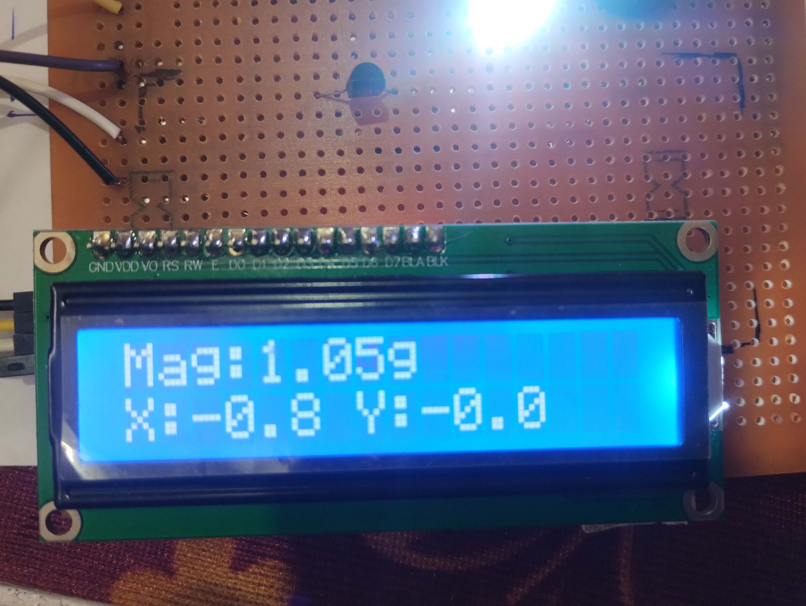
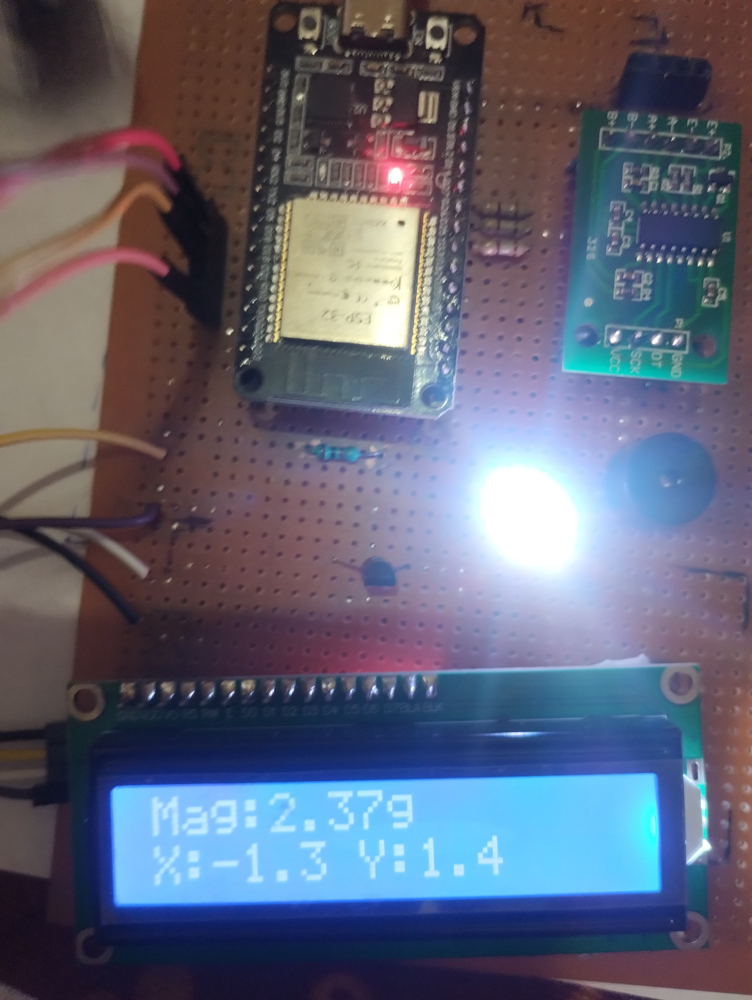
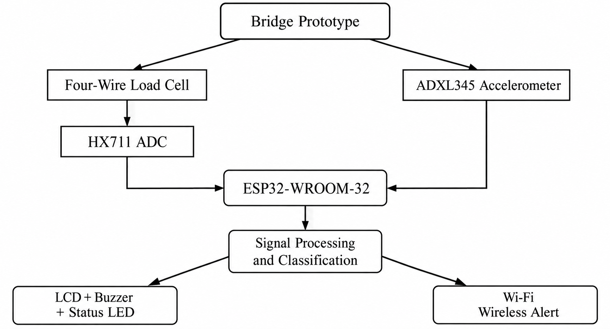

# IoT-Based Smart Bridge Health Monitoring System

A prototype bridge-health monitoring system built around an **ESP32-WROOM-32**, an **ADXL345 three-axis accelerometer**, an LCD, and local visual/audio alerts. The repository contains the integrated firmware, hardware diagnostic sketches, and example photographs/graphs from prototype tests.

> **Prototype status:** This is an educational proof of concept, not a certified structural-health monitoring system. The integrated firmware currently uses HX711 as the ADC to convert the analog readings of Load cell to process by ESP32. Vibration thresholds are prototype values and require calibration and validation on the actual mounted structure.

## Index

- [Project Overview](#project-overview)
- [Features](#features)
- [Prototype Demonstration](#prototype-demonstration)
  - [LCD and Indicator States](#lcd-and-indicator-states)
  - [Vibration Graphs](#vibration-graphs)
- [System Architecture](#system-architecture)
- [Hardware and Pin Mapping](#hardware-and-pin-mapping)
- [Repository Structure](#repository-structure)
- [Requirements](#requirements)
- [Getting Started](#getting-started)
- [Using the Web Dashboard](#using-the-web-dashboard)
- [Vibration Monitoring Logic](#vibration-monitoring-logic)
- [Load Monitoring Status](#load-monitoring-status)
- [Diagnostics](#diagnostics)
- [Configuration and Calibration](#configuration-and-calibration)
- [Known Limitations](#known-limitations)
- [Troubleshooting](#troubleshooting)
- [Safety and Disclaimer](#safety-and-disclaimer)

---

## Project Overview

The goal of this project is to demonstrate how a small embedded system can monitor a model bridge, display sensor information locally, and expose a browser-based dashboard over Wi-Fi. The current prototype focuses on two categories of input:

1. **Vibration / acceleration:** the ADXL345 measures acceleration along three axes. The firmware derives a filtered vibration signal and evaluates it against configurable prototype warning and critical criteria.
2. **Load / overload demonstration:** the integrated interface shows normal, warning, and critical load states.

An I²C LCD provides a local readout. An RGB LED and buzzer provide additional status indications. A web dashboard provides live plots, status cards, and controls for testing the prototype.

## Features

- ESP32-based embedded controller.
- ADXL345 three-axis accelerometer on I²C.
- 16×2 LCD with I²C backpack.
- RGB LED status indication.
- Transistor-driven buzzer output.
- Wi-Fi connection with a browser-based HTTP dashboard.
- mDNS hostname configured as `dashboard` (typically accessed as `http://dashboard.local` on compatible local networks).
- Live acceleration graphing and buffered sample access through the dashboard.
- Prototype vibration warning and critical states.
- Simulated load values and load-state demonstrations.
- Independent diagnostic sketches for I²C, ADXL345, LCD, RGB LED/buzzer, HX711 raw communication, and Wi-Fi/HTTP.

## Prototype Demonstration

The photographs and graphs below are visual records of the prototype and example test captures. They are included to communicate the intended interface and demonstrate the difference between relatively steady baseline readings and disturbed vibration traces. They should not be interpreted as calibrated engineering measurements or proof of structural safety.

### LCD and Indicator States

<table>
  <tr>
    <td align="center" width="50%">
      
      <br><strong>Normal load display</strong>
    </td>
    <td align="center" width="50%">
      
      <br><strong>Critical load display</strong>
    </td>
  </tr>
  <tr>
    <td align="center" width="50%">
      
      <br><strong>Baseline vibration display</strong>
    </td>
    <td align="center" width="50%">
      
      <br><strong>Abnormal vibration display</strong>
    </td>
  </tr>
</table>

The LCD photographs show the local display during normal-load, critical-load, baseline-vibration, and abnormal-vibration demonstrations. The RGB indicator supplements the displayed state. The load figures in the integrated firmware are simulated, so the load-state photographs demonstrate the interface and alert path. The acceleration figures can vary with sensor orientation, mounting rigidity, motion, and environmental noise.

### Vibration Graphs

<table>
  <tr>
    <td align="center" width="50%">
      
      <br><strong>Baseline vibration — capture 1</strong>
    </td>
    <td align="center" width="50%">
      
      <br><strong>Baseline vibration — capture 2</strong>
    </td>
  </tr>
  <tr>
    <td align="center" width="50%">
      
      <br><strong>Short burst vibration</strong>
    </td>
    <td align="center" width="50%">
      
      <br><strong>Abnormal vibration — capture 1</strong>
    </td>
  </tr>
  <tr>
    <td align="center" width="50%">
      
      <br><strong>Abnormal vibration — capture 2</strong>
    </td>
    <td width="50%" align="center">
      <em>Compare baseline captures with the short-burst and abnormal-vibration captures to inspect the changes in the plotted acceleration traces.</em>
    </td>
  </tr>
</table>

The baseline captures show comparatively steady traces, while the short-burst and abnormal-vibration captures include transient changes and oscillations. These plots are useful for demonstrating signal acquisition and visual comparison. They do not, on their own, establish a universal boundary between safe and unsafe bridge behaviour. Meaningful thresholds require repeatable tests, a defined sensor mounting arrangement, suitable filtering, and validation against the physical model and intended use.

## System Architecture

At a high level, the prototype follows this data and feedback path:



The LCD and ADXL345 share the I²C bus. The ESP32 performs the vibration calculations and updates local and web status. The web interface is hosted by the ESP32 itself, so the browser and board must be reachable on the same local network.

## Hardware and Pin Mapping

The current firmware uses the following assignments. Confirm them against your actual board and wiring before powering the circuit.

| Component / Signal | ESP32 GPIO | Notes |
|---|---:|---|
| I²C SDA — LCD and ADXL345 | GPIO 21 | Shared data line |
| I²C SCL — LCD and ADXL345 | GPIO 22 | Shared clock line |
| RGB LED — Red | GPIO 14 | Active LOW in the firmware |
| RGB LED — Green | GPIO 26 | Active LOW in the firmware |
| RGB LED — Blue | GPIO 27 | Active LOW in the firmware |
| Buzzer driver input | GPIO 25 | Active HIGH control; use a suitable transistor driver |
| HX711 DOUT | GPIO 33 | Used by standalone diagnostics; integration status is described below |
| HX711 SCK | GPIO 32 | Used by standalone diagnostics; integration status is described below |

### Important Electrical Notes

- ESP32 GPIOs use 3.3 V logic and are not 5 V tolerant.
- Use a suitable current-limiting resistor for each RGB LED channel (180R is used here).
- The current RGB logic assumes a common-anode LED. Verify the actual LED type and pinout.
- Drive a 5 V buzzer through a suitable transistor/driver stage rather than directly from a GPIO (BC547 is used here).
- Keep a common ground between the ESP32 and connected modules.
- Confirm the LCD backpack and ADXL345 breakout supply and I²C pull-up arrangements are compatible with the ESP32.

## Repository Structure

```text
.
├── BHMS.ino
├── README.md
├── images/
│   ├── Screen - Normal Load - 1.jpg
│   ├── Screen - Critical Load - 1.jpg
│   ├── screen-baseline-vibrations-1.jpg
│   ├── screen-abnormal-vibrations-1.jpg
│   ├── Graph - Baseline Vibrations - 1 - Light Mode(2) - Black Border.png
│   ├── Graph - Baseline Vibrations - 2 - Light Mode(1) - Black Border.png
│   ├── Graph - Short Burst Vibrations - 1 - Light Mode(1) - Black Border.png
│   ├── Graph - Abnormal Vibrations - 1 - Light Mode(1) - Black Border.png
│   └── Graph - Abnormal Vibrations - 2 - Light Mode(1) - Black Border.png
└── diagnostics/
    ├── README.MD
    ├── 01_I2C_Scanner.ino
    ├── 02_ADXL345_Diagnostic.ino
    ├── 03_LCD_I2C_Test.ino
    ├── 04_RGB_Buzzer_Test.ino
    ├── 05_HX711_Raw_Diagnostic.ino
    ├── 06_WiFi_HTTP_Diagnostic.ino
    └── 07_HX711_Calibration_Factor.ino
```

The `BHMS.ino` file is the integrated prototype firmware. The `diagnostics/` directory contains standalone sketches intended to isolate and test individual hardware modules. Read [`diagnostics/README.MD`](diagnostics/README.MD) before running those sketches.

## Requirements

### Hardware

- ESP32-WROOM-32 / compatible ESP32 DevKit.
- ADXL345 accelerometer breakout.
- 16×2 LCD with I²C backpack.
- RGB LED and appropriate series resistors.
- Buzzer and a suitable transistor driver circuit.
- HX711 and load cell for separate raw diagnostic testing; the integrated sketch does not currently read this module.
- Suitable USB data cable, wiring, and power supply for the selected modules.

### Software

- Arduino IDE.
- Espressif ESP32 board package.
- A compatible `LiquidCrystal_I2C` library for the LCD.
- `HX711` library for the ADC. 
- ESP32 Arduino core networking libraries (`WiFi`, `WebServer`, and `ESPmDNS`), normally included with the ESP32 board package.

The HX711 raw and calibration diagnostics require a compatible HX711 library; see the diagnostics README for wiring, calibration steps, and details.

## Getting Started

### 1. Review the Wi-Fi Configuration

Before uploading, open `BHMS.ino` and locate the Wi-Fi credential definitions near the beginning of the file. The firmware currently includes network credentials in source code. 

### 2. Open the Integrated Sketch

1. Open `BHMS.ino` in Arduino IDE.
2. Select the correct ESP32 board profile and serial port.
3. Ensure a compatible `LiquidCrystal_I2C` library is installed.
4. Click **Verify** to compile.
5. Connect the hardware according to the pin table.
6. Upload the sketch.
7. Open Serial Monitor at **115200 baud** and inspect the startup and connection messages.

### 3. Connect to the Dashboard

After the ESP32 connects to Wi-Fi, note its IP address from the serial output. Open that IP address in a browser on a device connected to the same local network.

The configured mDNS hostname is `dashboard`, so `http://dashboard.local` may also work if the operating system and network support mDNS resolution. If it does not, use the IP address printed by the ESP32.

The browser and ESP32 must be able to communicate on the local network. Guest Wi-Fi isolation, client isolation, firewall rules, or different network segments can prevent access even when the ESP32 reports a successful connection.

## Using the Web Dashboard

The integrated sketch hosts a browser dashboard on HTTP port 80. Its interface includes status information, vibration plots, and controls for demonstrating the prototype's alert and display behaviour. The exact controls available are those implemented in `BHMS.ino`.

The dashboard obtains data from the ESP32; it is not a cloud service. Keep the browser on the same reachable local network as the board. The dashboard is intended for controlled local testing, not for exposure to the public internet.

### Local Display and Alerts

- The LCD can display load-related status or acceleration-related readings, depending on the selected screen.
- The RGB LED indicates the current status category.
- The buzzer provides rhythmic audible feedback for warning/critical conditions as implemented in the firmware.
- The dashboard shows status and plotted samples and can provide manual controls for demonstration and testing.

### Simulated Load Warning Levels

The integrated sketch currently defines a load warning threshold at **4.0 kg** and a critical threshold above **5.0 kg**. However, the load value is simulated in firmware. These values therefore demonstrate the user interface and alert path only; they do not currently represent a real-time measurement from a load cell.

## Vibration Monitoring Logic

The firmware reads the ADXL345 over I²C and uses the three acceleration axes to derive a vibration signal. Its current prototype configuration includes:

| Parameter | Current Setting | Meaning |
|---|---:|---|
| ADXL345 output data rate | 200 Hz | Sensor output-rate configuration |
| High-pass filter coefficient | `0.0305` | Approximate 1 Hz high-pass behaviour at the configured sampling rate |
| Rolling RMS window | 200 samples | Approximately one second at 200 samples/second |
| Warning RMS threshold | `0.040 g` | RMS threshold for the warning condition |
| Warning clear RMS | `0.030 g` | Lower threshold used for clearing the warning condition |
| Sustained warning duration | 3 seconds | Warning RMS must remain elevated for the configured duration |
| Critical peak threshold | `0.300 g` | Filtered-magnitude local-peak threshold |
| Critical peak count | 4 peaks | Four qualifying distinct peaks within the rolling window |
| Critical peak window | 3 seconds | Time window used to count qualifying peaks |
| Minimum peak spacing | 150 ms | Helps avoid counting closely spaced samples as separate peaks |

The firmware uses filtered acceleration magnitude to detect qualifying local peaks and a rolling RMS measure to detect sustained vibration. It also uses separate warning/critical clearing behaviour to reduce immediate state flicker when measurements approach thresholds.

**These settings are starting points for prototype experimentation, not validated structural limits.** Results depend on sensor orientation, mounting, sampling behaviour, filtering, mechanical coupling, model construction, and background noise. Do not transfer these thresholds directly to a real bridge or use them as a safety certification criterion.

## Load Monitoring Status

Use [`07_HX711_Calibration_Factor.ino`](diagnostics/07_HX711_Calibration_Factor.ino) to calculate the HX711 calibration factor from a known mass. This is a standalone calibration utility; it does not automatically modify or integrate load-cell readings into the main firmware.

The project hardware includes an HX711/load-cell diagnostic sketch, but the integrated `BHMS.ino` currently does not read the HX711. The HX711 pins are reserved in the code, and the dashboard's load state is simulated.

Consequently:

- Load numbers displayed by the integrated sketch are not live sensor measurements.
- The 4 kg warning and greater-than-5 kg critical levels are software demonstration thresholds.
- The standalone HX711 diagnostic can help investigate raw sensor communication, but raw counts are not calibrated mass.
- Actual load measurement requires correct mechanical mounting, validated wiring, a stable excitation and ADC setup, calibration with known loads, repeatability tests, and integration into the main firmware.

Do not describe the current prototype as having verified live overload detection until the HX711 path has been integrated and validated.

## Diagnostics

The [`diagnostics/`](diagnostics/) directory contains seven standalone sketches:

| Sketch | Purpose |
|---|---|
| `01_I2C_Scanner.ino` | Finds I²C devices and reports their addresses |
| `02_ADXL345_Diagnostic.ino` | Checks ADXL345 identity and acceleration readings; includes text/plot modes |
| `03_LCD_I2C_Test.ino` | Tests LCD initialization and text output |
| `04_RGB_Buzzer_Test.ino` | Tests the RGB LED channels and buzzer driver |
| `05_HX711_Raw_Diagnostic.ino` | Checks HX711 readiness and raw ADC readings |
| `06_WiFi_HTTP_Diagnostic.ino` | Tests Wi-Fi and a simple HTTP endpoint |
| `07_HX711_Calibration_Factor.ino` | Calculates an HX711 calibration factor using a known mass and checks the result |

Run them one at a time and consult [`diagnostics/README.MD`](diagnostics/README.MD) for wiring, library requirements, commands, and expected behaviour. Uploading a diagnostic sketch replaces the integrated program on the ESP32 until `BHMS.ino` is uploaded again.

## Configuration and Calibration

Before treating any output as meaningful measurement data:

1. **Fix the mechanical installation.** Mount the ADXL345 rigidly and consistently on the model. A loose sensor or flexible mounting can dominate the readings.
2. **Check orientation.** Record which physical direction corresponds to X, Y, and Z. Axis values change when the board is rotated.
3. **Capture baseline data.** Record multiple runs with the model stationary and under known repeatable conditions.
4. **Repeat disturbance tests.** Use repeatable, documented inputs rather than relying on a single tap or visual impression.
5. **Review filtering and thresholds.** Tune them against the collected data and intended demonstration, and document why the chosen values were selected.
6. **Integrate load sensing separately.** Verify HX711 raw stability, mechanical load-cell mounting, tare, and calibration before connecting its readings to the dashboard.
7. **Re-test the complete system.** Sensor noise, Wi-Fi activity, power changes, and the integrated sampling loop can change behaviour compared with isolated diagnostics.

Keep test conditions and threshold changes documented in the repository so results can be reproduced.

## Known Limitations

- The integrated load value is simulated for the time being in the `BHMS.ino`.
- Vibration thresholds are prototype settings and are not validated for real structural-health monitoring.
- The ADXL345 is a general-purpose accelerometer; the quality of vibration interpretation depends on mounting, sampling, filtering, and calibration.
- A browser dashboard on the local network is not an authenticated or encrypted remote-monitoring service.
- Wi-Fi availability and mDNS resolution depend on the local network.
- The images are example prototype captures, not certified test reports.
- Hardware, libraries, and wiring should be verified on the actual build; a repository description is not a substitute for compiling and testing the code.

## Troubleshooting

### The ESP32 Does Not Connect to Wi-Fi

- Verify the SSID and password in the local sketch.
- Confirm that the network provides 2.4 GHz Wi-Fi. `Turn on Extend Compatibility (2.4GHz) settings in case of device.`
- Check the serial output for the assigned IP address and connection state.
- Try the IP address directly if `dashboard.local` does not resolve.
- Ensure the browser device and ESP32 are on the same reachable network and that client isolation is disabled.

### The LCD Is Blank or Shows Blocks

- Run the I²C scanner and confirm the LCD address.
- Verify GPIO 21/22, power, and common ground.
- Adjust the LCD contrast potentiometer.
- Confirm that the installed `LiquidCrystal_I2C` library matches the sketch's API.

### The ADXL345 Is Not Detected

- Run the I²C scanner first.
- Check whether the address is `0x53` or `0x1D`.
- Verify SDA/SCL, power, and ground.
- Check that the sensor breakout is an ADXL345-compatible board.
- Finally, adjust the contrast by turning the potentiometer on the back of the LCD's I²C Backpack.

### The Vibration State Changes Unexpectedly

- Check whether the sensor or model is moving mechanically.
- Verify that the sensor is rigidly mounted.
- Record baseline data before changing thresholds.
- Review the high-pass filter, RMS window, peak count, and timing settings.
- Avoid treating a single graph or threshold crossing as conclusive evidence of a structural fault.

### The Load Display Does Not Follow the Real Load Cell

This is expected with the current integrated firmware: load is simulated. Use `05_HX711_Raw_Diagnostic.ino` to investigate the separate HX711 hardware, then integrate calibrated measurements into the main sketch as a distinct development step.

## Safety and Disclaimer

This repository demonstrates embedded sensing, local status indication, and a Wi-Fi dashboard on a model bridge. It is not designed, certified, or validated for monitoring a real bridge or making safety-critical decisions.

Use suitable electrical protection, verify voltage and logic-level compatibility, and disconnect power before modifying wiring. Do not expose the unauthenticated HTTP diagnostic/dashboard to untrusted networks. Do not rely on the prototype's thresholds, simulated load values, or example plots to determine whether a structure is safe.

